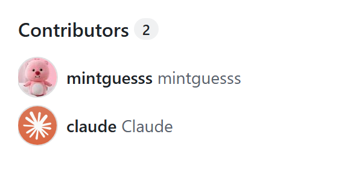
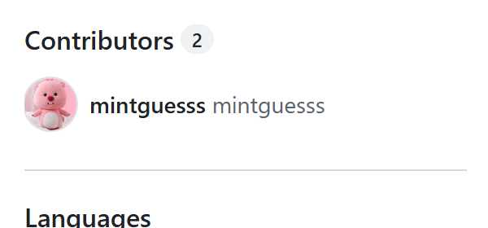

# clean-contributors

[](https://github.com/mintguesss/clean-contributors/actions/workflows/ci.yml)
[](LICENSE)
[](#install-claude-code)

**Get Claude (or any unwanted account) off your GitHub repository's Contributors list — and keep it off.**

[中文說明](#中文說明)

You removed the `Co-authored-by: Claude` lines, maybe even rewrote the commits, and GitHub *still* shows Claude under **Contributors**. That list is cached and GitHub does not recompute it just because history changed. This plugin fixes both halves of the problem:

| Skill | What it does | Changes anything? |
| --- | --- | --- |
| `check-contributors` | Finds out *why* the account is listed: trailers still in history, or just a stale cache | No, read-only |
| `strip-coauthors` | Rewrites history to remove the matching `Co-authored-by` trailers and force-pushes | **Yes, rewrites history** (asks separately) |
| `refresh-contributors-cache` | Forces GitHub to recompute the Contributors list | Yes, briefly switches the default branch, then restores it |

Also included: standalone `refresh.sh` / `refresh.ps1` scripts for people who do not use Claude Code.

### Before / after

Tested on this repository itself: one commit with a `Co-Authored-By: Claude` trailer, then `strip-coauthors` and `refresh-contributors-cache`.

| Before | After |
| --- | --- |
|  |  |

## Install (Claude Code)

```
/plugin marketplace add mintguesss/clean-contributors
/plugin install clean-contributors@clean-contributors
```

Then, inside any session:

```
/clean-contributors:check-contributors OWNER/REPO
/clean-contributors:strip-coauthors OWNER/REPO
/clean-contributors:refresh-contributors-cache OWNER/REPO
```

Or just say *"remove Claude from the contributors of OWNER/REPO"* and Claude picks the right skills.

**Requirements:** [GitHub CLI](https://cli.github.com) logged in (`gh auth login`) with **admin** on the repository. `strip-coauthors` also needs [`git-filter-repo`](https://github.com/newren/git-filter-repo) (`pip install git-filter-repo`).

## Without Claude Code

The refresh step is a single script that talks to the GitHub API, so no clone is needed:

```bash
# macOS / Linux / Git Bash
bash plugins/clean-contributors/scripts/refresh.sh OWNER/REPO
```

```powershell
# Windows PowerShell
powershell -ExecutionPolicy Bypass -File plugins\clean-contributors\scripts\refresh.ps1 OWNER/REPO
```

It shows the repository, default branch, branch protection and open PRs, asks once (`-y` / `-Yes` to skip), and rolls everything back if any step fails.

To strip the trailers by hand (rewrites history — read the warnings below first):

```bash
git clone --mirror https://github.com/OWNER/REPO strip.git && cd strip.git
git bundle create ../backup.bundle --all
git filter-repo --force --message-callback '
import re
pat = re.compile(rb"^co-authored-by:[^\n]*(noreply@anthropic\.com|claude\[bot\])[^\n]*(\n|$)", re.I | re.M)
if not pat.search(message):
    return message
msg = pat.sub(b"", message)
return re.sub(rb"\n{3,}", b"\n\n", msg).rstrip(b"\n") + b"\n"
'
git remote add origin https://github.com/OWNER/REPO
git push --force origin 'refs/heads/*:refs/heads/*' 'refs/tags/*:refs/tags/*'
```

## How the refresh works

GitHub recalculates contributors when the default branch changes. The script makes that happen without touching your code:

1. create `tmp-refresh-contributors` at the same commit as the default branch
2. make it the default branch
3. rename the real default branch to `<name>-old-refresh` and back
4. make the real branch the default again
5. delete `tmp-refresh-contributors`

Commits, tags and open PRs are untouched (PRs follow branch renames). The web page can take a few minutes to catch up after the API does.

## Things to know

- **Fix history first.** If `Co-authored-by` trailers for the account are still in history, the account comes back after a refresh. Run `check-contributors` to find out.
- **Rewriting history is destructive.** New commit hashes, collaborators must re-clone or hard-reset, signed commits lose signatures, forks keep the old commits. `strip-coauthors` makes a backup bundle and asks for explicit confirmation.
- **Admin permission is required** to change the default branch and rename branches.
- **Branch protection** may block the rename or the force push; the skills check and tell you.
- **CI may run once.** Creating `tmp-refresh-contributors` is a push event, so workflows with an unfiltered `on: push` run on it. Check for deploy-on-push workflows before refreshing.
- **Commits *authored* by the account** (for example by `claude[bot]` from the Claude GitHub App) are not changed by `strip-coauthors`, which only removes trailers. `check-contributors` reports them separately.
- **Sandboxed / cloud agent sessions** often cannot change repository settings through their GitHub proxy. Run it from Claude Code on your own machine (CLI or IDE extension), or run the script directly.

## Tests

```bash
python3 tests/test_callback.py   # the filter-repo callback shown above
bash tests/test-refresh.sh       # both refresh scripts, against a fake gh (no network)
```

The fake `gh` in `tests/fake-gh` simulates the GitHub API and injects failures, so the rollback paths are tested too. CI runs both on every push.

## License

MIT

---

## 中文說明

**把 Claude（或任何不想要的帳號）從 GitHub 倉庫的 Contributors 名單拿掉，而且不會再長回來。**

明明已經刪掉 `Co-authored-by: Claude`，甚至改寫了 commit，Contributors 還是顯示 Claude？那是因為 GitHub 的名單有快取，歷史改了它也不會重算。這個 plugin 分三步處理：

| Skill | 用途 | 會改東西嗎 |
| --- | --- | --- |
| `check-contributors` | 找出原因：歷史裡還有署名，還是只是快取沒更新 | 不會，唯讀 |
| `strip-coauthors` | 改寫歷史，刪掉對應的 `Co-authored-by` 行並 force push | **會改寫歷史**（另外確認） |
| `refresh-contributors-cache` | 強制 GitHub 重算 Contributors | 會暫時切換預設分支，完成後還原 |

實測前後對比見上方 [Before / after](#before--after)（就是拿這個倉庫自己測的）。

### 安裝

```
/plugin marketplace add mintguesss/clean-contributors
/plugin install clean-contributors@clean-contributors
```

需要先安裝 [GitHub CLI](https://cli.github.com) 並登入（`gh auth login`），且對倉庫有 **admin** 權限。改寫歷史另外需要 `pip install git-filter-repo`。

不用 Claude Code 的話，直接跑腳本：

```powershell
powershell -ExecutionPolicy Bypass -File plugins\clean-contributors\scripts\refresh.ps1 OWNER/REPO
```

### 注意

- 歷史裡還有署名的話，刷新後名單會再長回來，先跑 `check-contributors`。
- 改寫歷史會改變受影響 commit 及其後所有 commit 的 hash，協作者要重新 clone，fork 會保留舊 commit。
- 建立暫時分支算一次 push，沒有限定分支的 `on: push` workflow 會跑一次；有「push 就部署」的 workflow 請先確認。
- `strip-coauthors` 只刪署名行，不會改由該帳號「作者」身分提交的 commit（例如 `claude[bot]`）。
- 雲端或沙盒環境的 agent 常常沒辦法透過代理修改倉庫設定，請在自己電腦上的 Claude Code（CLI 或 VS Code 插件）執行，或直接跑腳本。
